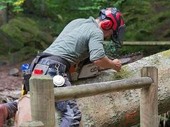
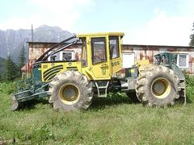
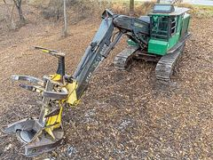
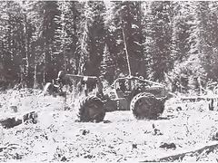
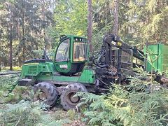
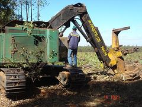
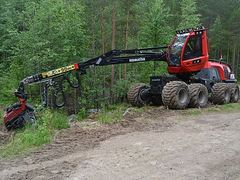
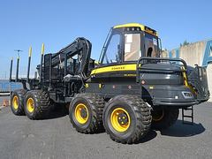
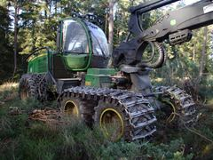

# Credits

Machine icons in `assets/machines/` are photographs from Wikimedia Commons, resized to 240x180 JPEG and centre-cropped. Licence text and author are as published on each file page.

| Icon | Machine | Photo | Licence | Author |
|---|---|---|---|---|
|  | Ground Crew | [Bûcheron affutant tronçonneuse.jpg](https://commons.wikimedia.org/wiki/File:B%C3%BBcheron_affutant_tron%C3%A7onneuse.jpg) | [CC BY-SA 4.0](https://creativecommons.org/licenses/by-sa/4.0) | Moinats |
|  | Kamuta MS-40 Mini Skidder | [HSM 805 Articulated Skidder side view.jpg](https://commons.wikimedia.org/wiki/File:HSM_805_Articulated_Skidder_side_view.jpg) | [CC BY-SA 3.0](https://creativecommons.org/licenses/by-sa/3.0) | Gabinho |
|  | Tigrix F-200 Feller-Buncher | [Feller buncher-4.jpg](https://commons.wikimedia.org/wiki/File:Feller_buncher-4.jpg) | [CC0](http://creativecommons.org/publicdomain/zero/1.0/deed.en) | Wikideas1 |
|  | Kamuta GS-70 Grapple Skidder | [Articulated grapple rubber tired skidder (1982).jpg](https://commons.wikimedia.org/wiki/File:Articulated_grapple_rubber_tired_skidder_(1982).jpg) | Public domain | unknown |
|  | Pondrix 8W Forwarder | [John Deere 1510G forwarder near Mörsdorf.jpg](https://commons.wikimedia.org/wiki/File:John_Deere_1510G_forwarder_near_M%C3%B6rsdorf.jpg) | [CC BY-SA 4.0](https://creativecommons.org/licenses/by-sa/4.0) | Steffen Mokosch |
|  | Tigrix F-550 Track Feller | [Fellerbuncher.JPG](https://commons.wikimedia.org/wiki/File:Fellerbuncher.JPG) | Public domain | Conrado |
|  | Stagbrook 1170 Harvester | [Komatsu 901XC harvester in Muuratsalo 01.jpg](https://commons.wikimedia.org/wiki/File:Komatsu_901XC_harvester_in_Muuratsalo_01.jpg) | [CC BY 4.0](https://creativecommons.org/licenses/by/4.0) | Antti Leppänen |
|  | Pondrix 14W Heavy Forwarder | [Ponsse Elephant forwarder Vuosaari.jpg](https://commons.wikimedia.org/wiki/File:Ponsse_Elephant_forwarder_Vuosaari.jpg) | [CC BY 4.0](https://creativecommons.org/licenses/by/4.0) | Antti Leppänen |
|  | Stagbrook 1470 Heavy Harvester | [Wartenberg Landenhausen John Deere forest harvester ds.png](https://commons.wikimedia.org/wiki/File:Wartenberg_Landenhausen_John_Deere_forest_harvester_ds.png) | [CC BY-SA 3.0](https://creativecommons.org/licenses/by-sa/3.0) | UuMUfQ |

Fallback illustrations (no suitable licence-free photo found): `processor.svg`, `drone.svg`, `swarm.svg`, `titan.svg`. Drawn for this project, released under the same licence as the game.

Photos are used under their stated licences. CC BY and CC BY-SA images require attribution, which is given here. CC BY-SA images are used unmodified apart from resizing and cropping, so the share-alike terms apply to the image files themselves.
